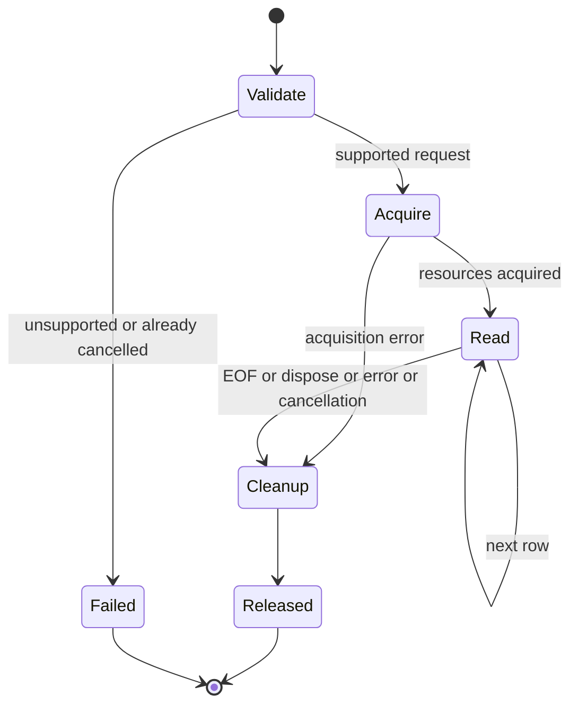

# Modern execution contract proposal

This proposal makes M1 in the [roadmap](modernization-roadmap.md) concrete: genuine driver async queries and commands, cancellation, streaming, isolated scopes and redacted diagnostics. It is D1.0 in the [implementation plan](modernization-implementation-plan.md). No interface below is implemented or approved. M0 completion still gates production M1 dispatch; preparing this contract independently does not bypass that dependency.

The selected .NET standard governs technical constraints, including API compatibility, secret disclosure, structured telemetry and verified runner behavior. The development/autonomous guides govern decision authority, real-source evidence and execution gates. The existing no-regression measurement does not waive workflow coverage targets. Pending V0.2, V0.7 and V1c.6 decisions remain separate.

## Source observations and driver readiness

| Actual source | Constraint on the design |
| :--- | :--- |
| [IEntityProvider and IEntityTable](../IQToolkit/IEntityProvider.cs) | Existing interfaces and abstract sync APIs must remain implementable without new members. |
| [QueryExecutor](../IQToolkit.Data/Common/QueryExecutor.cs) | Compiled plans return synchronous IEnumerable and integer command results. Adding abstract async members would break external subclasses. |
| [ExecutionBuilder](../IQToolkit.Data/Common/ExecutionBuilder.cs) | ExecuteProjection calls Execute/ExecuteDeferred; aggregators, client joins, batches and command sequences compose synchronous execution. Reusing this plan inside an async-looking wrapper would retain synchronous I/O. |
| [EntityProvider.GetExecutionPlan](../IQToolkit.Data/EntityProvider.cs) | Translation already separates policy, mapping and language. Reuse the translated representation, then build an async-specific execution plan. |
| [DbEntityProvider](../IQToolkit.Data/DbEntityProvider.cs) | Connection ownership currently uses shared counters/flags; a closed-start sync query buffers, while an open-start query can stream. Transaction and Log are mutable. These fields are not an async concurrency contract. |
| [SqlClient batching](../IQToolkit.Data.SqlClient/SqlQueryProvider.cs) | SqlDataAdapter batching is synchronous. Renaming it or awaiting completed tasks cannot establish an async batch capability. |
| [Central driver versions](../Directory.Packages.props) | Installed versions are Microsoft.Data.SqlClient7.1.1, Microsoft.Data.Sqlite10.0.12, MySql.Data26.7.0 and System.Data.OleDb10.0.12. Do not silently replace drivers. |

The resolved SqlClient7.1.1 net10.0 project uses net9.0 reference/runtime assets and Unix/Windows runtime choices. Its installed reference XML declares cancellation-token overloads for OpenAsync, ExecuteReaderAsync, ExecuteNonQueryAsync and ReadAsync. Historical `artifacts/modern-execution/source-inspection.json` established API presence; two assumed tagged-source paths returned404. The later [exact-version source matrix](modernization-driver-capabilities.md) resolves immutable unified paths, installed asset/copy identities and operation-specific fallbacks: cold physical opening uses blocking work on workers, transactions/disposal inherit synchronous implementations, and command/reader packet paths are async under the declared switch configuration. No live cancellation/server or entirely nonblocking lifecycle is established.

Microsoft.Data.Sqlite's ADO.NET async methods execute synchronously. It remains a synchronous provider and a useful sync regression control; it cannot close M1's genuine-I/O acceptance. [SQLite async limitations](https://learn.microsoft.com/en-us/dotnet/standard/data/sqlite/async)

ADO.NET base implementations can also call synchronous methods for opening, executing, committing or disposing. Method names, overrides or already-completed tasks alone are insufficient proof. Record capability separately for connection opening, command execution, row reading, transaction operations and cleanup, using exact driver source and live operation evidence. [DbConnection.OpenAsync](https://learn.microsoft.com/en-us/dotnet/api/system.data.common.dbconnection.openasync?view=net-10.0), [DbCommand async fallback](https://learn.microsoft.com/en-us/dotnet/api/system.data.common.dbcommand.executedbdatareaderasync?view=net-10.0), [DbTransaction.CommitAsync](https://learn.microsoft.com/en-us/dotnet/api/system.data.common.dbtransaction.commitasync?view=net-10.0), [reader disposal](https://learn.microsoft.com/en-us/dotnet/api/system.data.common.dbdatareader.disposeasync?view=net-10.0)

The first proposed live slice considered the existing SqlClient adapter against an approved SQL Server endpoint. Exact-source inspection now exposes its unsatisfied genuine-opening/lifecycle prerequisite; no fully async SqlClient production dispatch or silent relaxation is permitted. Independent PostgreSQL/Npgsql feasibility can inform an alternative future slice, while public selection/contract and production gates remain open. MySQL remains a separate candidate until exact-driver behavior and an endpoint are verified; OleDb is Windows-specific and has no established true-async capability here. No SQL Server endpoint or hosted native execution is currently qualified.

## Additive public entry points

Proposed names below are reviewable signatures, not existing APIs. Keep them in the current core/Data boundary and isolate hosting packages; no vendor SDK type becomes mandatory in the core. Use Task for one-shot operations and IAsyncEnumerable for rows. An optional interface preserves external IEntityProvider implementations:

```csharp
public interface IAsyncEntityProvider : IEntityProvider
{
    IAsyncEnumerable<T> ExecuteQueryAsync<T>(
        Expression expression,
        CancellationToken cancellationToken = default);

    Task<TResult> ExecuteScalarAsync<TResult>(
        Expression expression,
        CancellationToken cancellationToken = default);
}
```

Add IQueryable extensions such as AsAsyncEnumerable, ToListAsync, CountAsync and FirstOrDefaultAsync that construct/dispatch the relevant expression to this seam. Preserve existing LINQ result and cardinality semantics: Single must distinguish no row/one row/multiple rows; Count remains a translated aggregate where supported. ToListAsync explicitly buffers; AsAsyncEnumerable streams. An unsupported provider or request must fail before acquisition under the recommended contract. Do not fall back through IQueryProvider.Execute, Task.Run, blocking waits or a synchronous iterator.

For parameterized command access, propose an additive Data-level ExecuteCommandAsync(QueryCommand, object[], CancellationToken) returning Task<int>. Reuse existing QueryCommand/QueryParameter metadata and bind values as parameters; do not concatenate application values into SQL. Snapshot the supplied parameter list at operation start. Mutable complex values retain their existing converter contract and must not be modified concurrently by the caller; a shallow list snapshot is not a claim of deep immutability.

The proposed Data-level extension of the optional interface is:

```csharp
public interface IAsyncDbEntityProvider : IAsyncEntityProvider
{
    AsyncExecutionCapabilities AsyncCapabilities { get; }

    Task<int> ExecuteCommandAsync(
        QueryCommand command, object[] parameterValues,
        CancellationToken cancellationToken = default);

    Task DoConnectedAsync(
        Func<IAsyncDbEntityProvider, CancellationToken, Task> operation,
        CancellationToken cancellationToken = default);

    Task DoTransactedAsync(
        Func<IAsyncDbEntityProvider, CancellationToken, Task> operation,
        CancellationToken cancellationToken = default);
}
```

AsyncExecutionCapabilities is a proposed immutable declaration with separate support fields for connection opening, commands, queries/row reads, begin/commit/rollback and nonblocking cleanup. It is not a runtime certification status: the published support matrix carries exact version/environment evidence. The field types/names and any capability restrictions are fixed during owner review before implementation. Genuine async execution cannot be inferred from async cleanup availability or vice versa.

Add scope operations only after their capabilities and ownership contract are accepted. A connected/transaction callback receives the scope-bound provider and token explicitly; it must get tables from that provider. Scope callbacks are awaited before completion. A scope holds its connection/transaction lifetime lease; each sequential query or command acquires and releases a separate child operation lease. Holding the scope itself does not count as an active child operation. Nested connected/transaction callbacks on that scope are initially rejected before I/O; later nesting requires an explicit contract. Do not introduce an implicit global connection or promise ambient transaction propagation. Public interface names, capability exposure and callback signatures are owner-reviewed decisions before code.

## Execution-plan seam and full M1 inventory

Retain QueryExecutor and existing ExecutionBuilder.Build unchanged for synchronous callers. Add a separate async executor/plan builder rather than new abstract obligations on legacy subclasses. Private naming and file organization are reversible implementation choices.

The proposed async plan contains command metadata, parameter evaluation, row projectors, result cardinality and explicit child-operation/composition nodes. Compile CPU-only parameter/projector expressions as today; an async runner owns every driver operation. A projector containing a nested synchronous executor call is not an acceptable async plan. Cancellation tokens, connections, transactions and current parameter values are invocation state, never cached executable-plan constants.

| Delivery slice | Required behavior; eventual M1 scope is retained |
| :--- | :--- |
| First command/query capability | Flat server projection and parameterized command reach the installed driver's OpenAsync/ExecuteReaderAsync/ReadAsync/ExecuteNonQueryAsync. Early stream disposal closes its resources. |
| Scalar/cardinality and expression composition | Translate aggregates where supported; await row-based cardinality reducers; preserve conversions, ordering and existing scalar errors. |
| Multi-command/entity changes and batches | Await every operation, bind each parameter set, report affected rows/partial outcomes without implying atomicity; qualify adapter-specific batching independently. |
| Client joins, includes and deferred associations | Build explicit async child-operation paths; document materialization/buffering required by lookup construction. Never invoke sync I/O during an async projector. |
| Transactions and connected scopes | Prove supported async begin/commit/rollback/cleanup and caller ownership; separate-scope isolation and failure behavior remain required. |
| Hosting and diagnostics | Optional scoped DI integration, safe logging, ActivitySource/Meter, error taxonomy and redaction contract below. |

A first slice can reject unimplemented plan shapes before I/O, with a stable explanation. That is a temporary slice limitation, not deferral or completion of the full M1 inventory. Do not certify global bounded memory for queries intentionally requiring client-side lookup materialization; streaming and materializing shapes have separate measured acceptance.

Async compiled queries need distinct plan/cache identity including execution mode and relevant immutable configuration. They must not collide with sync compiled delegates. Capture replacement and explicit compiled-delegate snapshots remain different contracts. The initial slice can compile per invocation; cache integration is a required later task, not permission to reuse an unsafe legacy sync plan. Do not resolve pending V1c.6 policy replacement implicitly through an async cache.

## Ownership, streaming and concurrent scopes

Recommended public contract: one active child operation per provider/physical connection. A connected/transaction scope may run sequential child operations while retaining its scope lease; child completion does not close a connection opened by the enclosing scope. Reject overlap before the second operation performs I/O; do not silently queue behind an unconsumed stream. Separate scopes use separate connections, transactions and mutable mapping/policy state. Existing New(mapping/policy) overloads share a connection, so they do not establish isolated scopes.

Proposed callback-exit rule: every started child task and stream must finish or be disposed before callback completion. An unstarted stream may escape creation, but cannot begin after its scope exits. If callback completion finds a started child still active, fail the scope contract before commit, prohibit new child acquisitions, signal that scope's child cancellation and await its operation/reader cleanup before rollback and connection release. The scope itself disposes tracked idle partially consumed child streams; cancellation alone cannot resume a suspended iterator to run its finally block. If MoveNextAsync/native I/O is outstanding, await its settlement before disposing that stream. Do not wait for consumer disposal that can occur only after the scope task returns. Never commit or close underneath an outstanding native call. Preserve an original callback failure if present; otherwise report the lifetime violation. Cleanup deadlines request cancellation and mark failed resources unusable; they do not authorize concurrent disposal beneath native I/O or promise bounded completion when the driver does not honor cancellation. The scope await may remain pending until native work settles. This proposal needs owner acceptance and live-driver evidence before implementation.

The optional hosting factory creates a provider per scope with its own connection and mapping/policy configuration. Do not share BasicMapping's lazy dictionary or mutate a captured policy across scopes merely because a factory is singleton. Sharing immutable metadata is a separately verified optimization. Register a factory/immutable options as singleton where appropriate, provider scopes as scoped, and avoid captive scoped dependencies.

| Resource | Created by toolkit scope | Supplied by caller |
| :--- | :--- | :--- |
| Connection object | Scope disposes it after all child cleanup. Outside a scope, an operation closes its own opened lease. | Never dispose it; retain an initially open connection. Close a toolkit-opened lease only after child cleanup; an enclosing scope retains its lease until scope exit. |
| Transaction | Scope completes and disposes it; restores scope state on every exit. | Attach explicitly to all commands; never commit, roll back or dispose it. |
| Command/reader | Dispose after EOF, early disposal, failure or cancellation. | This API does not accept caller-owned command/reader objects; future escape hatches need their own contract. |

Async streams acquire nothing when created or when an unstarted enumerator is disposed. The first MoveNextAsync validates/evaluates the current request and acquires its operation lease. Keep the lease alive across yielded rows; a closed-start async stream does not use the legacy buffering shortcut. EOF, error, cancellation and DisposeAsync all converge on cleanup. An early break is correct only when the consumer disposes the enumerator, as await foreach does; abandoning a manually obtained enumerator does not guarantee immediate cleanup. The proposed stream is single-use; re-execute the query to obtain another stream.



The diagram means validation precedes acquisition, acquisition failures release partial resources, and every started stream releases reader/command/lease before completion. It does not describe implemented state transitions.

Legacy sync calls on a provider with an active async lease must be covered by the same overlap rule after owner approval. Direct access to a caller-owned connection cannot be intercepted reliably: the caller must not run unrelated commands, replace its transaction or dispose it during the lease. Concurrent MoveNextAsync on one enumerator is unsupported and rejected. Transaction mutation while an operation is active is likewise rejected through the provider surface.

## Cancellation, errors and cleanup

Pass one effective cancellation token to driver opening, executing and row reading. Combine API and enumerator tokens only when necessary and dispose the linked source. Check cancellation before acquisition and CPU-only translation/projection boundaries; never cancel one scope by cancelling another connection. A wrapper-level pre-cancel check is not evidence of cancellation of an active driver operation.

Preserve backend exceptions and useful native codes for the caller. Proposed cancellation rule: OperationCanceledException represents confirmed cancellation of this operation; a driver-specific cancellation response is normalized only after exact-driver acquisition establishes its signature, with the original response retained as InnerException. A DbException arriving while a token happens to be signalled is not automatically cancellation. Timeout, conflict, unsupported operation, caller cancellation and backend failure are separate outcomes. Public error normalization requires owner review.

Cleanup attempts reader disposal, command disposal, transaction cleanup when owned, connection lease closure when this operation or enclosing scope opened it, connection object disposal only when toolkit-owned, then lease release. Child cleanup retains the enclosing scope's open connection; outside a scope, a toolkit-opened lease on a caller-owned initially closed object is closed without disposing that object. Cleanup must not reuse an already-cancelled operation token. If the driver exposes cancellable cleanup, use a separately configured cleanup deadline; define that configuration in the approved slice rather than inventing a numeric timeout. Async method availability does not guarantee nonblocking cleanup, which has a separate capability entry.

If operation and cleanup both fail, deliver the original operation failure and record safe secondary-failure metadata; do not replace it with a cleanup exception. If only cleanup fails, fail the operation/disposal visibly. Attempt remaining cleanup even when one step throws. A connection whose cleanup failed must not be advertised as reusable. Commit cancellation/failure can leave the transaction outcome unknown: do not retry writes or claim rollback without driver/server evidence. No automatic retries or distributed transaction promise are introduced.

## Redacted diagnostics and legacy compatibility

Propose a small safe event contract emitted by the execution boundary, with optional Microsoft.Extensions.Logging/DI adapters. Core uses standard ActivitySource and Meter without a mandatory exporter; logging dependencies stay in an optional integration package. A compatible structured sink satisfies the selected standard's abstraction rule.

| Contract | Default fields and exclusions |
| :--- | :--- |
| Operation events | Stable event IDs for started/completed/failed/cancelled/cleanup-failed; operation kind, bounded provider identifier, phase, outcome, elapsed duration and rows/items read. |
| Traces | One execution span spans acquisition through cleanup; child phases may be measured when useful. Parent context propagates. No SQL statement, endpoint/connection string, parameter value, document/vector or arbitrary domain object. |
| Metrics | Duration histogram, active operation count, completed/failure/cancellation counts and rows read; labels only bounded provider/operation/outcome categories. No request/tenant/user/table/query IDs or arbitrary native-error text. |
| Failures | Safe classified category and allowlisted native code; no backend exception message or arbitrary object serialization by default. The caller still receives the original useful exception. |

Exception logging, when explicitly enabled for a classified safe exception, passes the exception object to the logger rather than reducing it to Message. The default failure event does not log arbitrary native exception objects because their contents can include values or SQL. Stable event/property names are versioned public telemetry contracts; exact names/units and adapter package versions are pinned before code.

SQL text and even a hash of SQL can reveal data, especially because constant-array binding may embed literals. Query inspection is an explicit caller operation, separate from default telemetry. Redacting only LogParameters would leave raw SQL/literal leakage. No automatic raw query fingerprint, sensitive-data logging toggle or credential-bearing endpoint tag is included in the initial proposal.

Existing TextWriter Log prints command text and parameter values in both sync and executor paths. Recommended compatibility treatment: retain that existing explicitly assigned sink as a documented sensitive legacy facility, never assign or bridge it automatically from the new hosting/diagnostics adapter, and make new telemetry safe by default. Whether to deprecate it, redact its output now, or introduce a reviewed compatibility exception remains an owner/security decision. Retaining the sink does not fix its disclosure finding or establish full standard compliance.

## Concrete owner decisions

These choices are needed before the corresponding production code, not before reviewing this proposal. Oracle clarity review cannot approve them.

| Decision | Recommended contract | Alternative requiring a revised proposal |
| :--- | :--- | :--- |
| D1-ASYNC-API | Accept the additive query/scalar/parameterized-command seam and unsupported-before-I/O behavior; single-use lazy async stream. | Different public signatures/lifetime or an explicitly labelled fallback surface; true-async certification still cannot use sync work. |
| D1-SCOPE | One active operation per provider/connection, explicit scope-bound callbacks and separate connections/mutable configuration per scope. | Queued operations or a separately designed concurrent provider; shared connections still need actual driver proof. |
| D1-DIAGNOSTICS | Safe new diagnostics; legacy TextWriter remains explicitly sensitive and is never enabled by hosting automatically. | Redact/deprecate legacy output now, with approved compatibility/security migration treatment. |
| D1-ERROR | Preserve backend failures; normalize only confirmed requested cancellation with original native response retained. | Preserve every native cancellation type without normalization, with a documented caller distinction. |

V0.2 remains limited to its named boundary tasks; async/error/cleanup simulators require a scope-bound amendment or actual acquired evidence. V0.7's policy decision remains unapproved. V1c.6's policy replacement decision remains unapproved. Contract acceptance does not approve fixtures, waive coverage, change milestone ordering or authorize paid resources.

## First live capability packet

Proposed ID M1.0, trace LOCAL-RM-M1, root coordinator/SDK owner. Expand these tasks into the execution plan after their gates are satisfied. Proposed source locations are new async executor/builder files beside the actual Common files, optional interfaces/extensions in IQToolkit and a SqlClient-specific adapter; final names are reversible implementation choices. Exact test/filter names below are proposed and do not exist yet.

| Ordered task | Prerequisite and observable output |
| :--- | :--- |
| M1.0a acquisition | Independent preparation: exact SqlClient7.1.1 source/API check; approved SQL Server endpoint/server version/OS, env-var-only credentials, permitted reads/commands and cleanup limits. Acquire real schema/rows and a driver-level async oracle without fabricated responses. Select a parameterized read and safe command from that environment. Complete M0 and accepted public contract remain prerequisites for production Test/Implement tasks M1.0c onward, not source/environment acquisition. |
| M1.0b cancellation acquisition | Capture a real active driver operation and an externally observed server execution state. Request cancellation after that state is observed; retain actual driver response/latency/cleanup. Polling has a recorded deadline and no fixed sleep used as proof of activity. Require permission for a long-running/cancellable command and its cancellation cost. |
| M1.0c Test | NativeAsyncQueryTests: async extension/flat translated query has its acquired row multiset, token propagation and early disposal with no sync I/O. Observe an intended failure such as unavailable async dispatch against the actual unchanged library. A compile error is not semantic RED; use a runnable existing-surface/reflection discovery check until the seam exists. |
| M1.0d Implement | Add only the approved query seam/async plan/SqlClient runner needed by that test; preserve legacy public abstract signatures. Reuse real acquired inputs; same-source GREEN and sync controls. |
| M1.0e Test | NativeAsyncCommandTests: approved parameterized command matches direct async oracle and command/lease cleanup; preserve its intended semantic RED before implementation. |
| M1.0f Implement | Minimal approved command dispatch/runner; unchanged command Test source and real oracle pass. |
| M1.0g Test | NativeAsyncCancellationTests: acquired active-operation case from M1.0b with intended semantic RED; do not substitute a pre-cancelled call. |
| M1.0h Implement | Minimal live cancellation propagation/cleanup; unchanged cancellation Test source passes without weakening the observed active-operation prerequisite. |
| M1.0i protecting gate | Strict ordinary tests/translations, scope-specific native filters, unchanged sync semantics, API/package/locked consumer gates and measured coverage/stream-memory evidence against the integrated snapshot; ATLAS and independent Oracle. |

Literal future focused command: `dotnet test IQToolkitTest/IQToolkitTest.csproj -c Release --no-restore -p:ContinuousIntegrationBuild=true -warnaserror --filter FullyQualifiedName~NativeAsyncQueryTests --logger 'trx;LogFileName=tests.trx' --results-directory <unique-run>`. Command/cancellation cases use their named filters. Source must be present and discovery counts checked before this command is acceptance evidence. The endpoint env-var name and operation permissions are recorded at acquisition; its value never appears in source, logs, prompts or artifacts.

Protecting commands remain `GITHUB_ACTIONS=true bash eng/verify.sh` and, after any production/compiler change, the existing API/package and reviewed lock-preparation→locked consumer verification flow. No consumer lock regeneration is accepted merely because a build fails. Apply current workflow touched-file targets/no regression and final-project target until the owner approves a scoped replacement.

Bounded-memory evidence needs an approved real result set and measured driver buffering configuration/cardinality. No dataset is fabricated and no number is invented here. The eventual acceptance matrix also includes unstarted/early/exhausted streams, reader/projector/acquisition errors, simultaneous separate scopes, owned/caller transactions, disposal failure, real cancellation during opening/executing/reading, every supported plan shape, safe telemetry and old public subclass/package consumers. Scope acceptance additionally runs two sequential child commands/queries inside one callback, overlapping-child rejection before I/O, callback return with an active task, callback return with a partially consumed stream, and attempted first enumeration after scope exit. Observe no commit/close before child cleanup and preserve borrowed connection-object ownership. Remaining M1 slices must be expanded and completed; this first packet alone cannot close M1 or unlock unsupported provider claims.

## Review and verification status

D1 is design-only. Source inspection and official documentation establish current architecture, installed API declarations and known fallback limits; no D1 SDK build/test, live async operation, performance claim or API implementation occurred. Its historical runtime checkpoint was77 tests/247translations with325 unconfigured SQL Server skips and zero warnings/errors. Later current evidence is recorded in AGENT_STATE.md; historical identities are not a claim about the evolving checkout. Independent source/environment probes, including the separate PostgreSQL feasibility packet, may proceed under their own bounded contracts without accepting D1's public API.

Independent Oracle review and any resulting corrections are recorded in the implementation plan. The document is ready only when its source assertions, signatures, ownership/error/diagnostic rules, pending decisions and complete-M1 inventory are clear. Owner acceptance and live evidence remain required before calling any async capability done.
