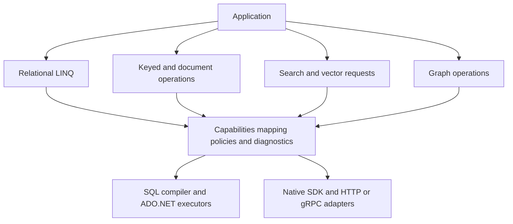

# IQToolkit modernization and feature expansion roadmap

IQToolkit can become a small, extensible .NET data access toolkit for applications that use several kinds of storage. Its strongest starting point is its LINQ expression translation, mapping, and provider infrastructure. The opportunity is to modernize that foundation and add useful access patterns for relational, key-value, document, analytical, vector, search, and graph databases.

**Recommended direction:** make the existing relational functionality dependable for modern applications, add PostgreSQL, and develop DynamoDB as the first managed NoSQL provider. Add vector retrieval, full-text search, and analytics through distinct capabilities. Evaluate Qdrant, Milvus, OpenSearch, DuckDB, and other databases on their application value and maintenance cost rather than aiming for the largest provider list.

This is a product and architecture roadmap for review, not a commitment to implement every candidate. Priorities and effort ratings are recommendations. New packages and APIs below are proposals; they do not exist in v1.1.1. No delivery dates are assigned because workload requirements and maintainer capacity have not been established.

## Intended users and product boundaries

The primary users are developers building ASP.NET services, background workers, data tools, and local applications who want typed queries and predictable database behavior without building a provider themselves. Provider authors are a second important audience: the toolkit should make it practical to support a bounded set of operations well.

The distinguishing value should be inspectable queries, explicit backend capabilities, consistent mapping and diagnostics, and reliable execution. A wrapper that only renames a vendor SDK is usually insufficient value. An adapter can still be worthwhile if it adds shared tenant policies, mapping, instrumentation, or query validation without replacing a mature native implementation.

The scope includes open-source databases and useful managed services. DynamoDB is an AWS service, not an open-source server. Self-hostability, server licensing, client licensing, and feature availability must be recorded separately when selecting provider versions. For example, MongoDB Community Server uses SSPL, which MongoDB states is not OSI approved; its drivers have different licensing. It should not be listed as an interchangeable open-source choice. [MongoDB licensing explanation](https://www.mongodb.com/legal/licensing/server-side-public-license/faq)

Initial boundaries:

- Retain relational LINQ, mapping, and update capabilities while adding separate APIs where the database model requires them.
- Do not promise joins across databases, distributed transactions, or universal LINQ support.
- Keep embedding generation and model hosting outside the core library; accept application-supplied vectors and offer optional ecosystem adapters.
- Leave cluster administration and general schema migration tooling to established tools. Provide schema requirements, compatibility checks, and examples.
- Keep Access as an explicitly Windows-specific compatibility provider. Preserve SQL Server Compact as legacy material rather than investing in new features for it.

## Current foundation and evidence

The baseline is the repository at `60ddef6`, tagged `v1.1.1`. These observations come from source inspection; this roadmap does not constitute a fresh runtime certification of the providers.

| Observed state | Evidence | Roadmap implication |
| :--- | :--- | :--- |
| The modern solution targets .NET 10 and carries version 1.1.1. | [Shared build properties](../Directory.Build.props), [SDK selection](../global.json), [solution](../IQToolkit.sln) | Preserve the current target while establishing an explicit support policy. |
| Entity operations and execution contracts are synchronous. | [IEntityProvider and IEntityTable](../IQToolkit/IEntityProvider.cs), [QueryExecutor](../IQToolkit.Data/Common/QueryExecutor.cs) | Async execution must reach the driver and execution plan; adding async extension names alone is insufficient. |
| Translation already separates mapping, policy, and query language. | [QueryTranslator.Translate](../IQToolkit.Data/Common/QueryTranslator.cs) | Reuse this separation for SQL providers and extract only the shared parts needed for other storage models. |
| Execution assumes ADO.NET commands, readers, connections, and transactions. | [DbEntityProvider](../IQToolkit.Data/DbEntityProvider.cs), [QueryCommand](../IQToolkit.Data/Common/QueryCommand.cs) | HTTP and gRPC providers should not inherit a fake SQL command model. |
| Query plans use runtime expression compilation. | [EntityProvider.Execute](../IQToolkit.Data/EntityProvider.cs), [PartialEvaluator](../IQToolkit/PartialEvaluator.cs) | Trimming and NativeAOT support require a dedicated investigation and bounded support claims. |
| Existing coverage includes SQLite integration tests and a Northwind translation harness; SQL Server suites require external databases. | [SQLite tests](../IQToolkitTest/SQLiteTests.cs), [translation harness](../Test/NorthwindTranslationTests.cs), [test setup](../README.txt) | Separate offline verification from provider certification and report skipped integration suites explicitly. |
| Logging can include command parameters; executor resource ownership needs review. | `LogParameters`, `ExecuteCommand`, `ExecuteReader`, and `Project` in [DbEntityProvider](../IQToolkit.Data/DbEntityProvider.cs) | Establish redaction defaults, cancellation, and disposal guarantees before expanding network integrations. |
| The untyped `QueryCache.Execute(IQueryable)` overload calls `Equals` rather than executing the expression. | [QueryCache](../IQToolkit/QueryCache.cs) | Add a focused regression and resolve this observed implementation anomaly in the reliability milestone. |
| No GitHub Actions workflows are tracked at the baseline. | Repository tracked-file inspection of `.github/` | Add repeatable build, test, package, and release checks. |

## Modernization priorities

### Reliable execution and compatibility

Begin with the behavior consumers already depend on. Review connection, command, reader, and transaction ownership during successful execution, exceptions, early enumeration termination, and cancellation. Specify whether a provider instance can be used concurrently; do not assume that a shared connection or transaction is thread-safe.

Add regression coverage for query-cache overloads, captured values changing between executions, null and empty array membership, nullable comparisons, and mapping cache identity. The recent array `Contains` rewrite makes null-array behavior especially relevant. Preserve the distinction between a language normalization and a user-authored `Enumerable.Contains` call whose null semantics may differ.

For compiled queries, verify isolation across mappings, providers, and tenant policies. A compiled-query cache is not a result cache. Cross-request result caching needs its own invalidation and consistency design and should remain optional.

Define public API compatibility checks, centralize release metadata, and publish separate NuGet packages with source links and symbols. Version properties currently coexist with explicit assembly attributes; replace this duplication with one authoritative version source. Keep provider SDK dependencies out of the core package and move legacy application-settings integration behind an optional compatibility layer where practical.

### Async execution and modern hosting

Add cancellation-aware query and command execution, streaming through `IAsyncEnumerable<T>`, async transaction operations where supported, and async disposal. Preserve the synchronous API for existing consumers. Document any driver that cannot provide genuinely asynchronous I/O; do not implement apparent scalability with `Task.Run` wrappers.

This work affects `QueryExecutor`, `DbEntityProvider`, `ExecutionBuilder`, and provider-specific executors. Prefer a narrow execution-contract design before modifying every expression-building path. Verify that cancellation reaches a live driver operation and that breaking out of a stream releases resources without buffering the complete result first.

Offer optional dependency injection and hosting integration, structured logging, `ActivitySource` tracing, and metrics for duration, retries, rows or items read, and provider failures. Default diagnostics should omit credentials, parameter values, document contents, and vectors. Distinguish caller cancellation, timeouts, conflicts, unsupported operations, and backend errors while retaining useful native error details.

### Modern query and mapping features

Prioritize features with broad application value:

- Document and extend mapping support for records and immutable objects, constructor selection, nullable reference metadata, explicit value converters, and modern date/time types.
- Explicit JSON and array mappings where supported, including missing-field versus null behavior for documents.
- Keyset pagination with deterministic ordering; cursor pagination for backends that expose continuation tokens.
- Parameterized raw-command escape hatches, query previews, and capability diagnostics.
- Optimistic concurrency and conditional updates with clear conflict outcomes.
- Batching and bulk operations that report partial failures and do not imply atomicity.
- Explicit tenant scope and soft-delete policies, with policy-bypass operations clearly identified and tested.

CTEs, window functions, richer aggregates, and database-specific functions are useful later relational extensions. Add them as explicit capabilities instead of requiring every provider to emulate them. Source generation and NativeAOT belong after profiling and a mapping prototype; runtime expression compilation and third-party drivers make blanket support claims premature.

Deliver these features through the M1q shared-feature track below. Before each provider starts, its workload and public-contract gate selects the mapping and query slices it needs and records the remaining features as deferred with a reason. Select complete behaviors, such as immutable projection plus constructor/converter tests, rather than requiring every provider to implement the entire list. Each selected slice gets its own implementation tasks and acceptance evidence; later provider milestones reuse that evidence and verify their backend-specific semantics.

## Database expansion priorities

The following rankings are architectural judgments, not benchmark results. Effort includes tests, documentation, and ongoing support: **M** means a bounded adapter or compatibility effort; **L** means a new execution or query surface; **XL** means both plus substantial operational validation. Existing SDK support reduces transport work, not semantic testing.

| Candidate and category | Useful application workloads | Recommendation and initial scope | Main tradeoff | Effort |
| :--- | :--- | :--- | :--- | :--- |
| [PostgreSQL through Npgsql](https://www.npgsql.org/doc/basic-usage.html), relational | SaaS applications, transactional services, JSON-rich data | Highest-priority new SQL provider through Npgsql; start with queries, CRUD, transactions, pagination, and type mapping. | Requires a real PostgreSQL dialect and behavioral tests, not only connection-string support. | L |
| MariaDB, relational | Existing MySQL-style applications and self-hosted services | Validate a named MariaDB version against the current MySQL provider before proposing another provider package. | Shared protocol does not prove identical SQL, types, or generated-key behavior. | M |
| [DynamoDB](https://docs.aws.amazon.com/sdk-for-net/v4/developer-guide/csharp_dynamodb_code_examples.html), key-value and document | AWS services with predictable access patterns, tenant partitions, event state | First managed NoSQL candidate; explicit key lookup, partition queries, conditional writes, and continuation tokens. | Request cost and consistency must remain visible; arbitrary LINQ predicates cannot become scans implicitly. | L |
| [DuckDB](https://duckdb.net/docs/introduction.html), embedded analytics | Local reporting, data exploration, Parquet-based workflows | First analytical candidate; bounded read/query support and explicit data import. DuckDB.NET offers an ADO.NET integration path. | Native package and ARM64 validation; avoid treating analytical storage as a general OLTP replacement. | M–L |
| [PostgreSQL with pgvector](https://github.com/pgvector/pgvector-dotnet), relational plus vectors | Semantic retrieval beside transactional metadata | First vector experiment once PostgreSQL works; reuse its connection and mapping infrastructure. | Extension provisioning, index choices, and approximate retrieval behavior require separate acceptance criteria. | M |
| [Qdrant](https://qdrant.tech/documentation/interfaces/), dedicated vectors | Recommendations, similarity search, retrieval with metadata filters | Preferred first standalone vector adapter; typed upsert, delete, filter, and top-k retrieval. | Ranking and search controls need an explicit contract rather than ordinary SQL ordering assumptions. | L |
| [OpenSearch](https://docs.opensearch.org/latest/clients/dot-net/), full-text and hybrid search | Catalog search, faceted discovery, searchable operational data | Prioritize when text relevance, facets, highlighting, or hybrid retrieval drive adoption. | Index mappings, analyzers, refresh behavior, and partial shard failures affect results. | L |
| [Milvus](https://milvus.io/docs/connect-to-milvus-server.md), dedicated vectors | Vector workloads with requirements that justify an additional engine | Run an interoperability and workload probe before committing to a supported provider. | Validate current C# client coverage, deployment footprint, and the chosen server/API versions. | L–XL |
| [ClickHouse](https://clickhouse.com/docs/integrations/language-clients/csharp/overview), columnar analytics | Event analytics, aggregates, time-oriented reporting | Follow DuckDB if users need a remote analytical server; start with reads and append/bulk ingestion. | Mutations and consistency need their own contract; do not inherit relational unit-of-work promises. | L |
| [CouchDB](https://docs.couchdb.org/en/stable/api/database/find.html) or [MongoDB](https://www.mongodb.com/docs/drivers/csharp/current/aggregation/), documents | Flexible records, document queries, synchronization-oriented applications | Evaluate CouchDB when its document API fits; for MongoDB prefer an adapter over rebuilding its existing C# LINQ implementation. | Missing versus null, arrays, revision/conflict semantics, and edition/licensing choices differ. | L |
| [Valkey](https://valkey.io/clients/), key-value | Cache entries, session-like state, expiring records | Consider a small keyed-access and TTL integration; keep result caching a separate optional feature. | General `Where` translation is a poor fit; invalidation and key scope matter more than SQL-like syntax. | M |
| [Neo4j](https://neo4j.com/docs/dotnet-manual/current/), graph | Relationship exploration, dependency graphs, recommendations | Demand-led graph package with parameterized Cypher or an explicit traversal API. | Graph traversal, path limits, and result shapes cannot be reduced to relational joins. | L–XL |
| [Apache Cassandra](https://cassandra.apache.org/doc/latest/cassandra/developing/data-modeling/intro.html), wide-column | Partition-oriented, write-heavy event or telemetry workloads | Defer until an application needs its data model; reuse keyed concepts proven by DynamoDB, not its service-specific semantics. | Queries follow partition design; driver support, paging, consistency, and deployment validation need a dedicated probe. | XL |

The linked primary documentation establishes integration paths and database models, not IQToolkit support or measured performance. MariaDB compatibility remains an unverified proposal.

Distributed SQL, time-series extensions, geospatial extensions, and embedded document stores remain useful discovery candidates. Prefer testing compatibility through an existing provider before creating a new package, but publish a separate support entry for each verified engine/version. A PostgreSQL-compatible wire protocol, for example, does not establish transaction or SQL compatibility.

## Provider architecture

Use a small shared capability and execution foundation with several query families. Keep the SQL compiler intact initially; adding DynamoDB should not require redesigning every SQL expression node.



This diagram describes logical responsibilities, not a single compulsory runtime class or a cross-database optimizer. New names such as `IQToolkit.Abstractions`, `IQToolkit.Data.PostgreSQL`, `IQToolkit.Data.DynamoDB`, and `IQToolkit.Search.OpenSearch` are proposed package boundaries, subject to review.

Shared contracts should cover operation context, cancellation, mapping metadata, capabilities, errors, diagnostics, and opaque continuation tokens. Relational operations keep transactions and row-oriented queries. Keyed operations expose keys, conditional writes, and partition queries. Retrieval operations return records together with rank and score metadata. Graph operations return bounded paths or explicit projections.

Capabilities must express constraints as well as booleans: required keys, valid sort fields, consistency options, supported filters, pagination behavior, and conditional transaction limits. Validate against the complete request and the selected server/client versions. Unsupported expressions should fail before I/O where possible, with a reason and a supported alternative. Client-side post-processing must be deliberate, bounded, and visible in diagnostics.

Retain access to native functionality through provider-specific extensions. Native SDK types may live at those explicit boundaries, but should not become mandatory dependencies of the shared core. Evaluate interoperability with the existing `Microsoft.Extensions.VectorData` abstractions before inventing overlapping vector contracts; assess the exact connector versions and supported operations during the probe. [Microsoft vector-store overview](https://learn.microsoft.com/en-us/dotnet/ai/vector-stores/overview)

## DynamoDB provider scope

DynamoDB should be a first-class access-pattern provider, not an implementation of every `IQueryable` operator. Its `Query` operation requires partition-key equality and permits a bounded set of sort-key conditions. Model those requirements directly and make index selection explicit. [AWS key conditions](https://docs.aws.amazon.com/amazondynamodb/latest/developerguide/Query.KeyConditionExpressions.html)

Proposed initial capabilities:

- Typed single-item reads, puts, updates, deletes, and conditional writes with an explicit conflict result.
- Partition queries, sort-key ranges or prefixes, projection, and a documented subset of attribute filters.
- Named table/index mappings and explicit choices for consistency.
- Page results containing items, an opaque continuation token, request diagnostics, and consumed-capacity information when requested.
- A separately named scan operation with explicit opt-in and item/request budgets. Never fall back to it because query translation fails.
- AWS SDK credential-chain and regional configuration integration, without credentials in mappings or logs.

The provider must preserve service behavior. A filter is applied after the query reads data and does not make that read free. Pagination must continue when a page contains no matching items but still has a continuation key; an empty page alone does not mean completion. `Take(n)` therefore needs defined semantics for returned items, service requests, and total budget. [AWS filter expressions](https://docs.aws.amazon.com/amazondynamodb/latest/developerguide/Query.FilterExpression.html), [AWS query pagination](https://docs.aws.amazon.com/amazondynamodb/latest/developerguide/Query.Pagination.html)

Tables and local secondary indexes support strong reads, while global secondary index reads are eventually consistent. Reject unsupported combinations rather than quietly downgrading consistency. Preserve missing attributes separately from explicit null values and define number, binary, collection, and date/time serialization. [AWS read consistency](https://docs.aws.amazon.com/amazondynamodb/latest/developerguide/HowItWorks.ReadConsistency.html)

Batch operations, transactional requests, TTL metadata, and change-stream integration are follow-on slices. Batches need partial-success reporting and bounded retries for unprocessed items; atomic transactions must have a separate API. Retry policy should have one owner so IQToolkit does not multiply SDK retry attempts or replay an unsafe write.

Acceptance requires local functional checks plus a disposable AWS integration environment for behavior that local emulation cannot establish. Record account, region, resource names, cost limits, and cleanup before those checks. Do not certify an alternative DynamoDB-compatible server solely on protocol compatibility.

## Analytical document and graph scope

For **DuckDB**, start with reporting queries over an embedded database and explicitly configured file sources. Support projections, aggregates, parameter binding, large-result streaming, and a bounded import operation. Validate native runtime distribution on ARM64 and x64. File and extension loading must be explicit application configuration, not inferred from untrusted query values. For **ClickHouse**, start with remote analytical reads and append ingestion; document write visibility and partial bulk failures before considering general updates or transaction-like APIs. These are proposed scope limits, not assertions that the engines have identical behavior.

For **document stores**, begin with ID-based operations, nested-field filters, projections, paging, and conditional replacement. Specify how missing fields, explicit nulls, arrays, and schema evolution map to C# objects. Choose CouchDB or MongoDB only after selecting the application's query and conflict requirements. Reusing MongoDB's existing LINQ implementation may provide more value per maintenance hour than another expression translator.

For **graphs**, begin with typed results from parameterized native queries and bounded traversals. Specify maximum depth, fan-out budgets, cycle handling, and path materialization before offering a fluent traversal language. Graph support should demonstrate a relationship-oriented application that is awkward with the current relational API.

For **Valkey**, keep initial operations centered on keys, conditional changes, and expiration. For **Cassandra**, require explicit partition-aware queries and a supported consistency model. Neither should inherit a relational identity map or automatic cross-record transaction assumptions. Promote these candidates only when their shared mapping, diagnostics, or policy integration provides a concrete advantage over using their SDK directly.

## Vector and search scope

Implement one retrieval contract with two concrete experiments before declaring it stable: pgvector for relational integration and Qdrant for a dedicated vector service. pgvector-dotnet exposes Npgsql integration; Qdrant provides a .NET SDK. These are integration starting points, not proof of identical features. [pgvector-dotnet](https://github.com/pgvector/pgvector-dotnet), [Qdrant interfaces](https://qdrant.tech/documentation/interfaces/)

Proposed retrieval requirements include vector dimensions and element types, distance metric, index or collection identity, model/version metadata, typed metadata filters, result projection, and explicit exact-versus-approximate search choices where available. Reject incompatible dimensions and non-finite values before dispatch. Do not compare raw scores from different engines as though they share a scale; expose metric, score direction, and rank, and document any optional normalization.

Preserve the distinction between filtering candidates before nearest-neighbor selection and filtering the returned top-k set. A backend that cannot express a required tenant or authorization filter should reject the request. Filtering an already retrieved top-k set can reduce recall and return fewer results, and must not become an implicit substitute for server-side isolation.

Add OpenSearch as a distinct search capability with index mappings, analyzers, text queries, filters, facets, highlights, bounded pagination, and explicit indexing/refresh behavior. Keep hybrid ranking configuration visible: OpenSearch combines subquery scores through a search pipeline, while Qdrant exposes its own hybrid-query model. IQToolkit should not promise matching rank order between them. [OpenSearch hybrid queries](https://docs.opensearch.org/latest/query-dsl/compound/hybrid/), [Qdrant hybrid queries](https://qdrant.tech/documentation/search/hybrid-queries/)

Milvus remains a credible candidate, but requires a bounded SDK/server compatibility probe. A C# SDK repository exists, while the current connection guide emphasizes Python, Java, Go, and Node.js and also demonstrates REST. Validate C# release coverage, cancellation, filters, and required retrieval operations; choose a supported SDK or a narrowly scoped REST adapter based on evidence. Do not infer current .NET feature parity from the repository's existence. [Milvus C# repository](https://github.com/milvus-io/milvus-sdk-csharp), [Milvus connection guide](https://milvus.io/docs/connect-to-milvus-server.md)

A later sample can combine an authoritative relational or DynamoDB store with a search index. Use an outbox or change feed, versioned idempotent updates, deletion propagation, replay checkpoints, and a rebuild path. Report index lag and stale-read behavior; this is eventual synchronization, not a distributed transaction. Embedding generation should be replaceable application infrastructure.

## Delivery sequence and acceptance gates

Milestone labels express dependencies, not promised release numbers. Only one new backend should be promoted to supported status at a time. DynamoDB and analytics do not technically depend on completing every PostgreSQL feature.

M2 and M5 share a small SQL capability design gate after M1. Define supported operations, type mappings, pagination, and failure behavior using the existing SQL providers and the next selected workload, and have the project owner review the public contract before adapter work. Either the PostgreSQL or analytics workstream can establish this gate; it does not require a completed PostgreSQL provider. Each provider then refines and verifies its own capabilities.

| Milestone | Outcome and affected areas | Depends on | Evidence required to close |
| :--- | :--- | :--- | :--- |
| M0 Release confidence | Harden existing behavior in `IQToolkit`, `IQToolkit.Data`, and the two test projects; establish package and CI checks. | Current baseline | Reproducible warning-free build; regression evidence for cache, array/null, mapping, and resource ownership; package-consumer smoke check; integration skips reported separately. |
| M1 Modern execution | Add true async execution, cancellation, resource ownership, optional hosting, and redacted diagnostics. Main changes in `QueryExecutor`, `ExecutionBuilder`, `DbEntityProvider`, and provider executors. | M0 | Cancellation of an active operation, early stream disposal, concurrent-scope isolation, bounded-memory streaming, and retained synchronous behavior against supported drivers. |
| M1q Shared mapping and query features | Deliver workload-selected slices from the modern query and mapping list: immutable/record mapping, converters and modern types; JSON/array/null handling; pagination; raw commands and query diagnostics; concurrency, batching, tenant and soft-delete policies. | M0; async execution slices also require M1. Runs alongside provider milestones rather than blocking all of them. | Every listed feature has a selected slice or an explicit deferral. Selected slices verify object construction/type round trips, null versus missing values, deterministic pagination, parameter binding, conflict/partial-failure outcomes, or policy isolation as applicable. Each consuming provider declares supported operations and verifies its own semantics. |
| M2 PostgreSQL | Deliver a usable relational provider and refine the SQL capability contract for PostgreSQL. Proposed `IQToolkit.Data.PostgreSQL`. | M1 and SQL capability design gate | CRUD, generated IDs, transactions, pagination, parameters, null semantics, and selected type mappings pass against a pinned server; unsupported features fail predictably. |
| M3 DynamoDB | Deliver keyed NoSQL access with explicit cost and consistency semantics. Proposed `IQToolkit.Data.DynamoDB` and minimal shared abstractions. | M1 and an approved keyed-operation contract | Keyed access, conditional-write conflicts, index consistency rejection, empty-page continuation, budgets, and no implicit scans are verified. AWS-specific checks run in the declared environment. |
| M4a Vector retrieval | First pgvector, then Qdrant, each accepted separately. Milvus receives a probe before provider work. | M1; pgvector also requires M2 | Real engine round trips, filter/isolation correctness, vector validation, top-k behavior, score interpretation, and cancellation; retrieval-quality results on a reviewed corpus. |
| M4b Full-text search | Deliver OpenSearch as a distinct search capability, selected by a text-search workload. | M1; independent of M4a | Index, update, and delete visibility under the declared refresh policy; text relevance on a reviewed corpus; filters and tenant isolation; facets, highlights, bounded pagination, cancellation, and explicit partial shard or bulk failure handling. Hybrid retrieval, if included, adds ranking-pipeline and quality checks. |
| M5 Analytics | DuckDB reads and data import first; ClickHouse only after a remote analytical workload is selected. Proposed separate analytical providers. | M1 and SQL capability design gate | Reproducible query results, native runtime compatibility, bounded streaming, supported type coverage, and documented write/transaction limits. |
| M6 Additional models | Select one document, graph, wide-column, or keyed-cache integration such as Valkey based on an actual consuming application. | M1 plus a model-specific contract and maintainer | A named use case, a demonstrated advantage over the native SDK, a supported version matrix, and tests for the model's distinct behavior. |

Suggested first implementation package: M0, followed by M1. Then prioritize M2 for relational adoption or M3 for an AWS application. Start retrieval only when a concrete similarity/search workload is selected; an analytics-focused application can choose M5 earlier. This ordering prevents all modernization effort from becoming dependent on an AI use case.

M1q supplies selected shared features throughout that sequence. A provider can start once its required slices and contracts are ready; completion of every shared feature is not a prerequisite. The project owner reviews workload selection and explicit deferrals when expanding each milestone into an implementation plan.

Before implementing a milestone, expand it into a bounded implementation plan with affected symbols, test-first tasks for behavior changes, data/environment prerequisites, and observable acceptance criteria. Complete a failing regression before its corresponding fix. Keep existing contracts protected while adding capabilities; a larger green test count is not a substitute for verifying the new behavior.

## Verification and support policy

Every new test, provider probe, benchmark, and retrieval-quality evaluation must identify its data sources in the implementation plan. Prefer approved fixtures, actual provider responses or approved captures, and appropriately licensed datasets. Any generated or fabricated evidence inputs require recorded human authorization naming the purpose, generator, and covered tasks, including test fixtures, provider payloads, randomized inputs, and retrieval corpora. Missing data or authorization is a prerequisite to resolve before dependent work, not permission to invent substitutes.

Use three distinct verification levels:

1. **Core checks:** expression translation, mapping, API compatibility, null semantics, and query validation without external infrastructure.
1. **Local provider checks:** real supported engines or their documented local environments, with explicit OS/architecture coverage. A SQLite run cannot certify another SQL dialect; an emulator cannot certify every managed-service behavior.
1. **Provider certification:** the declared server and SDK versions, authentication, pagination, consistency, cancellation, failure behavior, and packaging in a consuming application.

Start with the existing repository commands as the baseline gate, not as sufficient certification for future providers:

```bash
dotnet restore IQToolkit.sln
dotnet build IQToolkit.sln -c Release --no-restore -warnaserror
dotnet test IQToolkit.sln -c Release --no-build
dotnet run --project Test -c Release --no-build
```

New provider checks should receive explicit commands and environment setup in their implementation plans. Test Linux ARM64, the current development architecture, and a representative x64 environment. Windows-only providers need Windows evidence. Do not install or deploy every candidate database merely to prepare this roadmap.

For performance, establish measured baselines before choosing numerical gates. Record data provenance, cardinality, query shapes, concurrency, cold/warm state, server/SDK versions, index configuration, and hardware. Measure translation cost, allocations, throughput, tail latency, requests/read cost, and cancellation/disposal behavior. Retrieval also needs recall or relevance evaluation; latency alone cannot validate approximate search. Apply the data authorization policy above to benchmark inputs. No performance figures are claimed here.

Each provider should be labeled experimental, supported, or legacy. Promotion requires a named maintainer, supported operations and exclusions, a version/OS matrix, integration evidence, and a runnable example. Failing required integration checks blocks certification; unconfigured optional suites must be reported as skipped, not counted as successful provider verification.

Keep compatible additions in the 1.x line where practical. Use preview packages for unproven providers. Reserve 2.0 for approved changes that break public contracts or remove supported behavior, with migration notes and adapters where practical. Package availability on NuGet should be verified separately from Git tags; this roadmap does not assume the tagged versions have already been published there.

## Decisions for review

The IQToolkit project owner decides product priorities, public contracts, data authorization, cost commitments, and promotion to supported status. The defaults below are proposals for that review. Implementation agents may resolve reversible internal choices within the accepted scope; bounded probes should resolve empirical questions about provider behavior and feasibility.

| Decision | Recommended default | What could change it |
| :--- | :--- | :--- |
| Product identity | A modular query and execution toolkit with explicit database capabilities. | A decision to focus narrowly on a single storage family. |
| First new relational backend | PostgreSQL. | A concrete application requirement for another engine. |
| First managed NoSQL backend | DynamoDB with explicit keyed access. | A consuming application centered on document queries or offline synchronization instead. |
| First standalone vector backend | Qdrant, following or alongside a pgvector experiment. | Measured workload or deployment requirements that favor Milvus. |
| First analytical backend | DuckDB. | A workload that requires a shared remote analytics server immediately. |
| Provider commitment | One supported addition at a time; experimental status for unfinished integrations. | Additional maintainers and independent certification capacity. |
| Compatibility policy | Preserve the 1.x SQL API and add optional packages. | Evidence that an essential change cannot remain additive. |
| Workload and quality gates | Obtain representative queries, data provenance, desired consistency, and latency/cost objectives before each provider's implementation. | Reviewed requirements from the first consuming application. |

The project owner selected the Cross-Platform C#/.NET Engineering Standard (`ENG-STD-DOTNET-XPLAT`, version `1.1.0-draft.1`, baseline 2026-10-02) for implementation. Its technical rules and legacy adoption policy apply alongside the development-plan guide version 2.7, dated 2026-09-27, and the local Technical Markdown Style Guide. The [implementation plan](modernization-implementation-plan.md) records the selected source and execution gates. Selecting a standard does not establish whole-project compliance or provider certification.

External documentation was consulted on 2026-10-02. Provider APIs, SDK maturity, licenses, and supported runtime/server combinations must be rechecked when an implementation starts. Rankings, package boundaries, effort ratings, and proposed acceptance gates are IQToolkit recommendations rather than claims made by the referenced vendors.
